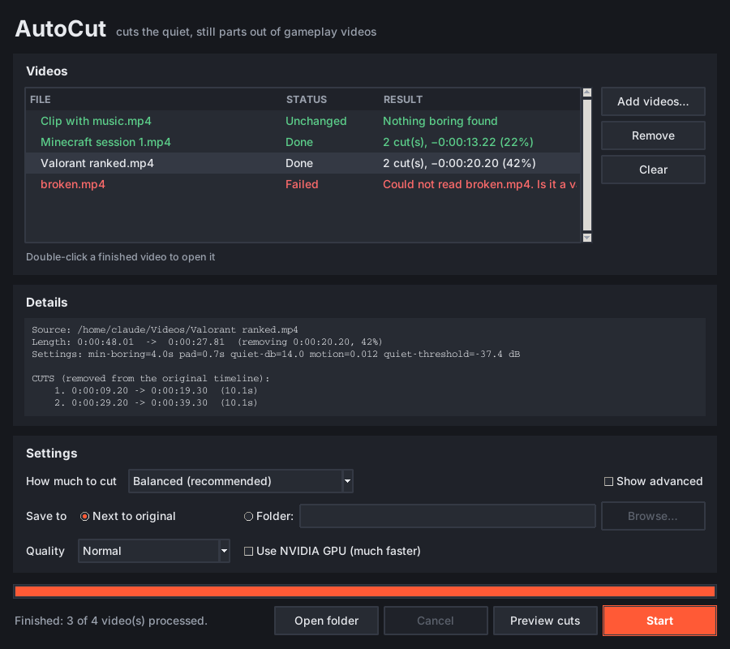

# AutoCut

**Cut the boring parts out of your gameplay videos automatically.** Free, offline, no account, no watermark.

AutoCut finds the stretches where nothing is happening — loading screens, menus, waiting in lobbies, going AFK — and removes them, leaving you with a tighter video that's ready to edit or upload.



## How it works

A stretch of video is cut only when it is **both**:

- **quiet** — the audio is well below the video's normal loudness, **and**
- **still** — almost nothing changes on screen.

Anything loud *or* moving is always kept, so action, commentary and cutscenes stay in. A little "breathing room" is left either side of each cut so the jumps don't feel abrupt.

Your original video is never modified. AutoCut saves a new `*_cut.mp4` next to it, plus a `*_cut.txt` listing exactly what was removed.

## Install

You need **Python 3.8+** and **ffmpeg**.

**Windows**

1. Install Python from [python.org](https://www.python.org/downloads/) — tick **"Add python.exe to PATH"** during setup.
2. Install ffmpeg: open a terminal and run
   ```
   winget install Gyan.FFmpeg
   ```
3. Download this repo (green **Code** button → **Download ZIP**) and unzip it anywhere.

**macOS:** `brew install python ffmpeg` · **Linux:** install `python3`, `python3-tk` and `ffmpeg` from your package manager.

No `pip install` needed — AutoCut only uses Python's standard library.

## Use it

### The app

Double-click **`autocut_gui.pyw`** (or run `python autocut_gui.pyw`).

1. **Add videos…** — pick one or more recordings (you can queue a whole session).
2. **Preview cuts** — quickly works out what would be removed, without making a new video. Click a video to see its cut list.
3. **Start** — cuts and saves the new videos. Double-click a finished video to play it.

**Settings**

| Setting | What it does |
|---|---|
| **How much to cut** | Presets: *Balanced*, *Cut more*, *Cut less*, *Game with constant music* |
| **Shortest cut** | Boring stretches shorter than this are left alone |
| **Breathing room** | Footage kept either side of each cut |
| **Quiet threshold** | Lower = more counts as quiet = more gets cut |
| **Still threshold** | Higher = more counts as still = more gets cut |
| **Use NVIDIA GPU** | Encodes with NVENC — much faster on NVIDIA cards |
| **Quality** | High / Normal / Smaller file |

Your settings are remembered between sessions.

> Optional: `pip install tkinterdnd2` lets you drag videos straight into the window.

### Command line

```
python autocut.py gameplay.mp4               # cut it -> gameplay_cut.mp4 + gameplay_cut.txt
python autocut.py gameplay.mp4 --dry-run     # only write the cut list
python autocut.py gameplay.mp4 --nvenc       # encode on an NVIDIA GPU
python autocut.py --help                     # all options
```

Tuning flags: `--min-boring`, `--pad`, `--quiet-db`, `--motion`, `--crf`.

## Tips

- **Game has music that never stops?** Use the *Game with constant music* preset, or lower the quiet threshold.
- **Cutting too much?** Use *Cut less*, or raise *Shortest cut*.
- **Run Preview first** on a new game to check the cuts look right before rendering.

## Limitations

- "Boring" is judged from sound and on-screen movement, not meaning. A dull stretch with lots of movement (e.g. driving down an empty road) is kept.
- It removes dead time; it doesn't add effects, music, zooms or captions.
- Variable-frame-rate recordings (some phone/screen recorders) may be very slightly off. OBS records at a constant frame rate by default, so OBS recordings are fine.

## How sync is kept

Cuts are snapped to exact video frame boundaries and the audio is cut with ~3 ms precision, so audio and video stay in sync no matter how many cuts are made. Tested on ffmpeg 6 and 7 at 30 and 59.94 fps.

## License

[MIT](LICENSE)
